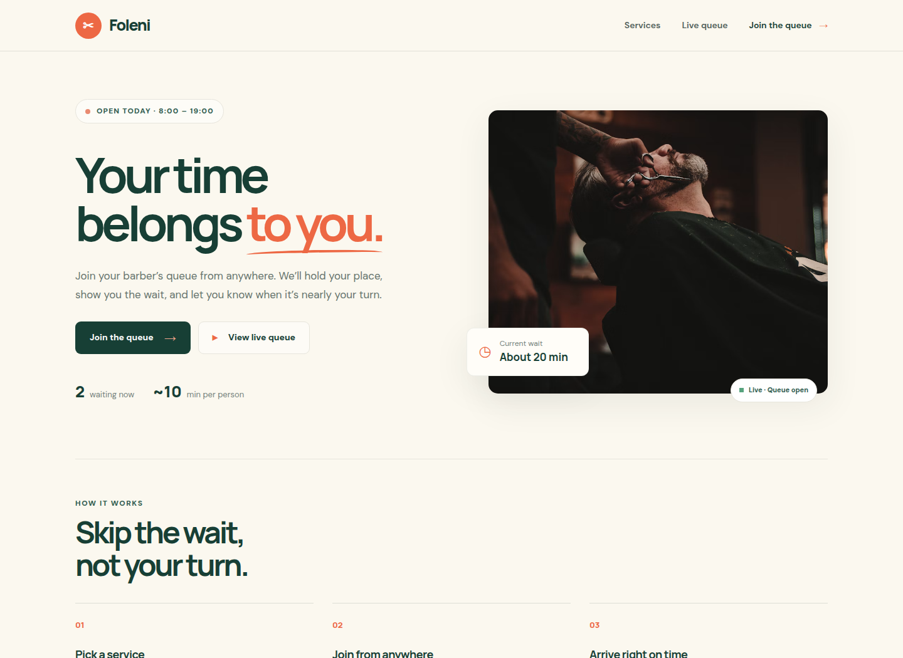
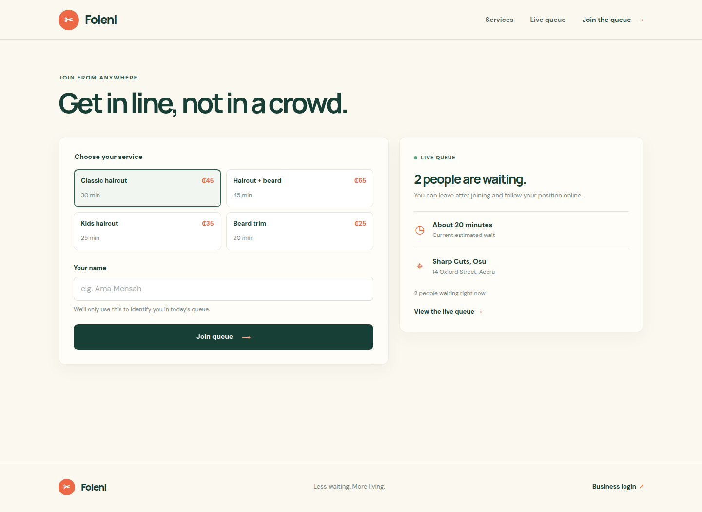
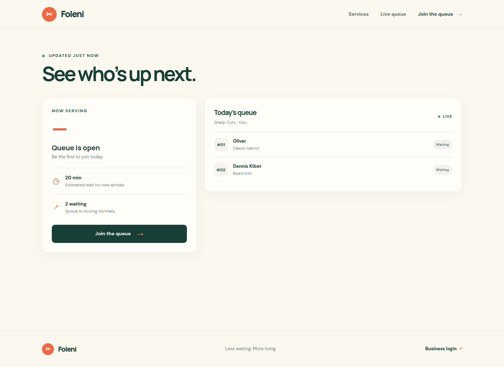
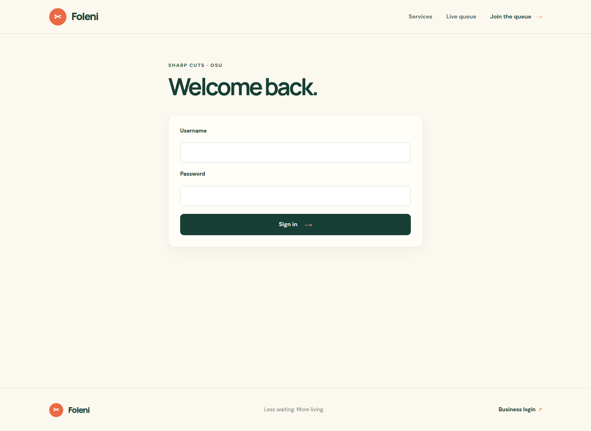

<div align="center">

# FOLENI

### A better way to wait.

Join the barbershop queue from anywhere, follow your place in real time, and arrive when it is nearly your turn.

<p>
  <a href="#-what-you-can-do">Explore features</a> ·
  <a href="#-get-started">Get started</a> ·
  <a href="#-screenshots">See the app</a>
</p>



<br>

**PHP 8+** &nbsp;·&nbsp; **MySQL / MariaDB** &nbsp;·&nbsp; **Responsive by design**

</div>

---

## ✨ What you can do

| For customers | For the shop |
| --- | --- |
| Browse services, prices, and estimated durations | Sign in to a protected business dashboard |
| Join the queue online with a name and service | See who is waiting and who is being served |
| Get a personal ticket and check your place in line | Advance the queue as each appointment is completed |
| Follow the live queue, refreshed every 30 seconds | Keep queue entries in a MySQL database |

## 🖼️ Screenshots

<table>
  <tr>
    <td align="center"><strong>Home</strong><br></td>
    <td align="center"><strong>Join the queue</strong><br></td>
  </tr>
  <tr>
    <td align="center"><strong>Live queue</strong><br></td>
    <td align="center"><strong>Business login</strong><br></td>
  </tr>
</table>

## 🚀 Get started

### Requirements

- PHP 8.0 or later
- MySQL or MariaDB
- PHP PDO MySQL extension

### 1. Create the database

The schema in `database/foleni.sql` selects a database named `foleni_db`. Create that database and a dedicated user with the permissions the app needs:

```sql
CREATE DATABASE foleni_db CHARACTER SET utf8mb4 COLLATE utf8mb4_unicode_ci;
CREATE USER 'foleni_user'@'localhost' IDENTIFIED BY 'replace-with-a-strong-password';
GRANT SELECT, INSERT, UPDATE ON foleni_db.* TO 'foleni_user'@'localhost';
```

Import the schema:

```sh
mysql -u foleni_user -p foleni_db < database/foleni.sql
```

### 2. Configure the database connection

Edit `config/database.php` and set `$host`, `$dbname`, `$username`, and `$password` to match your database. Keep real credentials out of version control.

### 3. Configure business login

Set both environment variables in the environment that runs PHP:

```sh
export FOLENI_ADMIN_USER='your-admin-name'
export FOLENI_ADMIN_PASSWORD='use-a-strong-unique-password'
```

### 4. Run locally

From the project directory, start PHP's built-in development server:

```sh
php -S 127.0.0.1:8000
```

Open [http://127.0.0.1:8000](http://127.0.0.1:8000). Make sure the database is running and the environment variables are available to the PHP server process.

## 🧭 Pages

| Page | Path | What it does |
| --- | --- | --- |
| Home | `/` | Browse the shop, services, and queue overview |
| Join queue | `/join_queue.php` | Choose a service and add your name |
| Live queue | `/queue_status.php` | Follow the line; ticket links use `?id=<queue-entry-id>` |
| Business login | `/login.php` | Sign in with the configured business credentials |
| Owner dashboard | `/admin.php` | View the active queue and advance service |

## 🗂️ Project layout

```text
.
├── admin.php                  # Business dashboard
├── index.php                  # Landing page
├── join_queue.php             # Customer queue form
├── login.php                  # Business sign-in
├── logout.php                 # Sign out
├── queue_status.php           # Live queue and ticket view
├── assets/
│   ├── css/style.css          # Responsive styles
│   └── js/script.js           # Mobile navigation
├── config/database.php        # PDO database connection
├── database/foleni.sql        # Queue table schema
└── includes/
    ├── functions.php          # Shared queue, escaping, and session helpers
    ├── header.php             # Shared site header
    └── footer.php             # Shared site footer
```

## 🔐 Production notes

- Use HTTPS and a strong, unique business password.
- Configure database credentials and login environment variables through your hosting provider's secret-management settings.
- Use a production-ready PHP web server rather than PHP's built-in development server.
- Google Fonts and the landing-page photo are loaded remotely, so those assets require an internet connection.

---

<div align="center">
Made for less waiting and better days.
</div>
